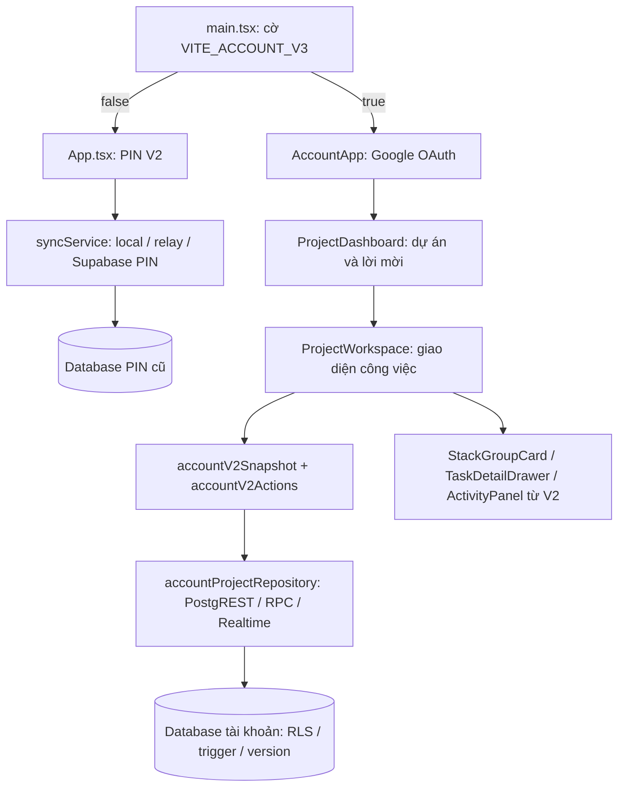

# Bàn giao tổng thể StackFlow

**Mốc kiểm tra:** 13/11/2026, trên máy local, nhánh `v2-google-auth`. Đây là điểm vào duy nhất để hiểu trạng thái dự án; các tài liệu ở cuối ghi chi tiết thiết kế và lịch sử. Trạng thái Git, database và bản triển khai có thể đổi sau mốc này, nên cần kiểm tra lại trước khi phát hành.

**Cập nhật sau mốc bàn giao:** Theo yêu cầu đưa đăng nhập Google vào bản chính thức 1.2.0, mã nguồn local đã chuyển `src/main.tsx` sang `AccountApp` mặc định. Luồng tài khoản chỉ dùng cấu hình Supabase đóng gói của project `xwzwsysekkizxmmjjjvn`, không đọc URL PIN từng lưu trong trình duyệt; build từ chối URL PIN. Những mô tả bên dưới về cờ `VITE_ACCOUNT_V3` là ảnh chụp lịch sử trước thay đổi này. GitHub repository variables vẫn trỏ đến database PIN; chưa đẩy hoặc triển khai thay đổi.

## 1. Điều cần hiểu trước tiên

- `1.2.0` là **số phiên bản phần mềm** trong `package.json`. `V2` và `V3` là **hai luồng sản phẩm** đang cùng tồn tại trong mã nguồn, không phải số phiên bản phát hành.
- **Bản PIN V2** là luồng đang phát hành theo ghi nhận vận hành. Điểm vào là `src/App.tsx`; người dùng vào bằng mã dự án/PIN và chọn thành viên.
- **Bản tài khoản Google** đang chạy và được thử trên local. Điểm vào là `src/components/account/AccountApp.tsx`; người dùng đăng nhập Google, xem dự án theo tài khoản và làm việc trên database tài khoản riêng.
- Hướng sản phẩm đã chốt: **giữ giao diện và đầy đủ tính năng V2, thay lớp PIN bằng đăng nhập Google và backend tài khoản**. Nhánh `v2-google-auth` đang thực hiện việc ghép này. Không xem giao diện V3 rút gọn là đích thay thế giao diện V2.
- Hai database khác nhau. Database PIN cũ vẫn phục vụ bản phát hành; database tài khoản là nơi thử luồng Google. Không chạy migration tài khoản lên database PIN, không trỏ client tài khoản vào database PIN và không xóa dữ liệu PIN khi chưa hoàn tất bàn giao/phát hành.

## 2. Bản nào nằm ở đâu

Thư mục ngoài `Source-Code/` là gói chia sẻ: `../Chay-Code-Local.bat` mở dev server, `../Mo-Web-StackFlow.url` trỏ tới GitHub Pages, `../Hinh-Anh-Demo/` chứa ảnh chụp giao diện PIN/V2, `../StackFlow-Checklist.apk` là APK cũ, và `../Database-Supabase/schema.sql` là bản schema đóng gói lịch sử. **Không dùng schema ở thư mục ngoài để dựng database tài khoản**; đường migration hiện hành là `Source-Code/supabase/migrations/`.

| Đối tượng | Vị trí / nguồn | Trạng thái tại mốc kiểm tra |
| --- | --- | --- |
| Mã nguồn đang làm | Thư mục này, nhánh Git `v2-google-auth`, HEAD `b8a875d` | Có thay đổi chưa commit; nhánh này đi trước `master` local 6 commit và `origin/master` 15 commit. |
| Mốc PIN V2 trong Git local | Nhánh `master`, HEAD `80dc360` | `master` local cũng đi trước `origin/master`; tên nhánh không chứng minh nội dung GitHub Pages đang chạy. |
| Web local tài khoản Google | `npm run dev`, `http://localhost:5173/` | `.env` local có `VITE_ACCOUNT_V3=true` và trỏ tới Supabase tài khoản. Người dùng đã xác nhận đăng nhập vào luồng này được. |
| Web build local | `dist/` | Lần build gần nhất báo `version: 1.2.0`; build từ working tree local. `dist/version.json` ghi build ID từ commit HEAD nên **không phản ánh các sửa đổi chưa commit**. |
| Web/PWA công khai | GitHub Pages, lối tắt `../Mo-Web-StackFlow.url` | Ghi nhận vận hành nói vẫn là PIN V2. Workflow chỉ tự deploy khi push `master`/`main`; chưa xác minh nội dung trang đang chạy trong lần bàn giao này. |
| APK có sẵn cho nhóm | `../StackFlow-Checklist.apk`, `release/v1.1.0/StackFlow-Checklist.apk` | File APK cũ v1.1.0; không phải build Android của luồng Google local. `release/ef221e2/` cũng chứa một APK cũ. |

`src/main.tsx` chọn luồng theo `VITE_ACCOUNT_V3 === 'true'`. `.env.example` để `false`; `.env` local để `true`. Workflow `.github/workflows/deploy.yml` lấy cờ này từ GitHub repository variable, **không** lấy `.env` local. Chưa xác minh giá trị biến trên GitHub trong lần bàn giao này. Không dùng cùng một số `1.2.0` để suy ra hai bản build có cùng tính năng.

## 3. Sơ đồ kiến trúc



### Tầng ứng dụng và dữ liệu

| Tầng | PIN V2 | Tài khoản Google |
| --- | --- | --- |
| Điểm vào & phiên | `src/App.tsx`, `PinAuthScreen.tsx`, phiên thành viên theo mã dự án/PIN | `AccountApp.tsx`, `AccountLogin.tsx`, `accountAuthService.ts`; phiên Supabase Auth với Google OAuth/PKCE |
| Màn hình dự án | Các component V2 trong `src/components/` | `ProjectDashboard.tsx` chọn dự án/nhận lời mời; `ProjectWorkspace.tsx` hiển thị dự án |
| Mô hình đọc/ghi | `src/services/syncService.ts`, dữ liệu `src/types/models.ts` | `src/core/domain/accountProject.ts`, `accountProjectRepository.ts`; `accountV2Snapshot.ts` và `accountV2Actions.ts` nối component V2 vào mô hình tài khoản |
| Quyền | Quy tắc thao tác trong ứng dụng PIN; schema cũ có giới hạn bảo mật riêng | Database tài khoản áp RLS, trigger và RPC theo `auth.uid()`, thành viên dự án và version |
| Đồng bộ | Local, E2EE relay hoặc Supabase PIN tùy cấu hình | Supabase PostgreSQL và Realtime; chỉnh sửa cần mạng, chưa có hàng đợi offline |

Mã domain thuần nằm tại `src/core/domain/`; `src/domain/stackDomain.ts` giữ các export tương thích của luồng cũ. `src/services/supabaseConfig.ts` tạo Supabase client chung, dùng PKCE và lưu phiên. `src/infrastructure/appearance/` và `src/infrastructure/updates/` phục vụ cả hai luồng. `src/infrastructure/notifications/` có phần dành cho PIN và phần tài khoản; hai hệ thống thông báo chưa hoàn toàn tương đương.

### Luồng Google và các loại tài khoản

1. Nút **Tiếp tục với Google** trong `AccountLogin.tsx` gọi `accountAuthService.signInWithGoogle()`, dùng Supabase OAuth provider `google`. Web quay về URL gốc; Android dùng `com.quang.stackflow://auth/callback`, được khai báo trong `android/app/src/main/AndroidManifest.xml`.
2. `AccountApp.tsx` đọc và theo dõi phiên đăng nhập. Đăng nhập thành công **không tự cấp quyền vào một dự án**. `ProjectDashboard.tsx` tải danh sách dự án và lời mời phù hợp tài khoản.
3. Tài khoản thường tạo dự án sẽ thành **owner** của dự án đó. Owner hoặc global admin mời người qua email. Người được mời phải đăng nhập bằng email đã xác minh và bấm nhận lời mời; lúc đó mới có membership.
4. **Member đang hoạt động** được đọc và cộng tác trong dự án; migration `202611130011` cho phép sửa chi tiết task giống V2. Quyền tick/mở lại task lớn thuộc người được giao task; task nhỏ thuộc người được giao riêng, hoặc người được giao task lớn khi task nhỏ chưa giao riêng.
5. **Owner** quản lý thông tin dự án, thành viên, lời mời, chuyển quyền chủ. **Global admin** là vai trò tách biệt: xem các dự án và quản lý cấp dự án, nhưng không là thành viên dự án, không tạo/tick công việc. Database giới hạn tối đa 20 thành viên đang hoạt động mỗi dự án.
6. `accountProjectRepository.ts` gọi PostgREST/RPC, xử lý xung đột version và nhận thay đổi Realtime. Quyền cuối cùng do database quyết định; UI chỉ ẩn/khóa thao tác theo vai trò để dễ dùng.

SQL gốc nằm ở `supabase/migrations/202611130001_fresh_account_schema.sql`; các migration `002`–`011` bổ sung phân công an toàn, quản lý thành viên, link, khóa tuần tự, nhật ký, thông báo và thứ tự. `supabase/legacy-schema.sql` cùng `supabase/legacy-migrations/` thuộc lịch sử PIN, không áp dụng cho database tài khoản. Google OAuth hiện được bật trên Supabase project tài khoản; mã nguồn không bắt buộc địa chỉ email phải có đuôi `@gmail.com`.

### Giao diện và hai thanh bên

`ProjectWorkspace.tsx` có thanh trái (tổng quan, Stack, thành viên), vùng task ở giữa và thanh nhật ký bên phải. Nút thu gọn riêng từng thanh đổi kích thước grid để vùng task rộng hơn. Trạng thái hai nút được lưu trên trình duyệt với khóa `stackflow_v3_sidebars`. Desktop dùng thanh bên; mobile dùng điều hướng dưới màn hình. Vùng task dùng `StackGroupCard`; drawer chi tiết dùng `TaskDetailDrawer`; nhật ký dùng `ActivityPanel` của V2 qua adapter tài khoản.

## 4. Trạng thái database và vận hành đã xác minh

- Supabase tài khoản: project ref `xwzwsysekkizxmmjjjvn`; bản local `.env` trỏ đúng project này. Truy vấn chỉ đọc ngày 13/11/2026 cho thấy **11 migration đã áp dụng, mới nhất `202611130011`**.
- Cùng truy vấn chỉ đọc xác nhận **0 project, 1 global admin grant, admin đó có danh tính Google và email đã xác minh, 0 membership dự án**. Không lưu email hay UUID vào repo. `specs/003-google-account-v3/tasks.md` đã cập nhật trạng thái bước bootstrap admin.
- `specs/004-v2-ui-google-auth/operations.md` ghi database PIN cũ được kiểm tra chỉ đọc và không bị sửa trong quá trình chuẩn bị. Số liệu PIN trong ghi chú là ảnh chụp thời điểm đó, không phải số liệu live của ngày bàn giao.
- Chủ dự án đã chấp thuận bắt đầu dữ liệu dự án trống khi chuyển sang Google. Dự án thử trên database tài khoản đã được dọn theo ghi nhận vận hành.

Không đưa URL có key, mật khẩu, khóa ký, email admin, UUID cá nhân hoặc dump database vào tài liệu hay commit. File `.env`, `supabase/.temp/` và mật khẩu database được bảo vệ bằng DPAPI trên máy này là cấu hình vận hành local, không phải dữ liệu nguồn để chia sẻ.

## 5. Thông báo, offline và cập nhật

- **PIN V2:** `notificationService.ts`, `pushRegistrationService.ts`, `supabase/functions/push-device` và `push-send` xử lý thông báo; Edge Function đăng ký thiết bị hiện kiểm tra thông tin phòng/PIN.
- **Tài khoản Google:** `AccountNoticeBell.tsx` cùng bảng thông báo tài khoản phục vụ hộp thông báo khi ứng dụng đang mở. Push khi ứng dụng đóng chưa được chuyển sang xác thực JWT tài khoản; không gọi phần này là hoàn tất.
- **Offline:** PIN có luồng local/relay riêng. Bản Google dùng server làm nguồn chính, báo mất mạng và chưa có hàng đợi thao tác + xử lý xung đột khi kết nối lại.
- **Kiểm tra cập nhật:** `package.json` là nguồn version; `vite.config.ts` nhúng version/build ID và tạo `dist/version.json`; `src/infrastructure/updates/updateService.ts` kiểm tra Web/PWA qua manifest này và APK qua GitHub Release. `android/app/build.gradle` tính versionName/versionCode từ package version.

## 6. Cách chạy và kiểm tra

Trong thư mục `Source-Code`:

```powershell
npm ci
npm run dev
```

Mở `http://localhost:5173/`. Với `.env` local hiện tại, đây là luồng **Google V3 trên nhánh tích hợp**, có màn hình đăng nhập Google. Địa chỉ `localhost:5173/` đã nằm trong redirect URLs được ghi ở `specs/003-google-account-v3/cutover.md`. `npm run preview` thường dùng cổng `4173`; không dùng cổng đó để kết luận OAuth hoạt động nếu chưa thêm redirect URL tương ứng trên Supabase.

Các cổng kiểm tra mã nguồn:

```powershell
npm test
npm run test:db
npm run test:backup
npm run lint
npm run build
```

Tại mốc bàn giao, `npm test` đạt **55/55**, `test:db` đạt kiểm tra RLS/lời mời/quyền tick/xung đột, `test:backup` đạt, lint sạch và build thành công. Đây là kiểm tra local; chưa thay thế kiểm thử thao tác thật bằng hai tài khoản Google, mất mạng, PWA và APK. Sau khi build, `dist/version.json` cho biết số phiên bản web local. `npm run cap:sync` build và chép web bundle sang Android; nó **không** tự tạo APK phát hành đã ký.

## 7. Việc đang dở, theo thứ tự cần xử lý

1. **Khóa phạm vi sản phẩm:** hoàn tất đối chiếu từng luồng V2 với bản tài khoản theo `specs/003-google-account-v3/parity.md`; giữ giao diện V2 và đăng nhập Google. Một số màn hình trong `ProjectWorkspace.tsx` vẫn có phần triển khai riêng bên cạnh component V2 được tái sử dụng.
2. **Sửa và kiểm chứng luồng lưu task:** `TaskDetailDrawer.tsx`, `ProjectWorkspace.tsx`, `accountV2Actions.ts` và repository đang có sửa đổi chưa commit nhằm xếp hàng các lần lưu nhanh, truyền version và giữ ID của subtask/link. Phiên tiếp tục đã đưa thao tác tick subtask vào cùng hàng đợi, tải subtask mới nhất trước khi tick, giữ các thay đổi cục bộ phát sinh trong lúc đợi và chặn các lần ghi tiếp sau khi lưu thất bại. Nút Lưu không gửi lại toàn bộ link đã được tự lưu. Có kiểm thử giao diện cho chuỗi thêm bước rồi tick nhanh. Build, lint và unit test đạt; thao tác nhiều bảng vẫn chưa nguyên tử, và thay đổi subtask/link từ thiết bị khác chưa làm tăng version task. Cần xử lý xung đột này, lỗi mạng giữa chừng, thêm/xóa liên tiếp và phân quyền bằng tài khoản thật.
3. **Đạt parity thông báo và offline:** push khi app đóng cần chuyển Edge Function/đăng ký thiết bị sang JWT tài khoản. Offline cần quyết định hàng đợi cục bộ, đồng bộ lại và cách giải quyết xung đột.
4. **Kiểm thử hệ thống thật:** ít nhất hai tài khoản Google, vai trò owner/member/global admin, Web desktop/mobile, Windows PWA, APK Android, đăng xuất/đăng nhập lại, callback OAuth, hai thiết bị sửa cùng một task và trạng thái mất mạng.
5. **Backup vận hành:** chọn nơi giữ bản sao mã hóa ngoài repo, giữ mật khẩu giải mã riêng, lên lịch backup và thử restore trên project tạm. Công cụ `scripts/backup-v3.ps1` và `scripts/backup-crypto.mjs` đã có; thử mã hóa/giải mã thành công chưa chứng minh quy trình khôi phục vận hành.
6. **Cutover và phát hành:** sau các cổng trên, xác nhận biến `VITE_ACCOUNT_V3` và cấu hình Supabase trên GitHub, đẩy mã đã kiểm tra, triển khai Web, xây APK đã ký và kiểm tra lại sau phát hành. Không dùng APK v1.1.0 ở thư mục gốc để thử tính năng Google. Chi tiết ở `specs/003-google-account-v3/cutover.md`.

## 8. Git và các thay đổi chưa commit

Tại mốc này, nhánh hiện tại là `v2-google-auth`. Các file chưa commit là:

```text
README.md
specs/003-google-account-v3/tasks.md
src/components/TaskDetailDrawer.tsx
src/components/__tests__/TaskDetailDrawer.test.tsx (mới sau mốc bàn giao)
src/components/account/ProjectWorkspace.tsx
src/infrastructure/projects/accountProjectRepository.ts
src/infrastructure/projects/accountV2Actions.ts
src/infrastructure/projects/accountV2Actions.test.ts
PROJECT_HANDOFF.md (tài liệu này)
```

Danh sách trên là ảnh chụp thời điểm tạo tài liệu; luôn chạy `git status --short` trước khi tiếp tục. Không reset, checkout đè hoặc gom commit mà chưa đọc diff. Những thay đổi chưa commit ở luồng lưu là công việc đã làm trong phiên này, chưa phải bản phát hành.

## 9. Nguồn đọc tiếp

- Quyết định sản phẩm và ranh giới tích hợp: `specs/004-v2-ui-google-auth/plan.md`.
- Nhật ký thao tác trên database tài khoản và PIN cũ: `specs/004-v2-ui-google-auth/operations.md`.
- Checklist hiện tại và đối chiếu tính năng: `specs/003-google-account-v3/tasks.md`, `parity.md`.
- Cấu hình OAuth, backup và quy trình cutover: `specs/003-google-account-v3/cutover.md`.
- Phát hành Web/APK: `.github/workflows/deploy.yml`, `UPDATES.md`, `release-notes.json`.
- Lịch sử thiết kế PIN và thông báo: `HANDOFF_LEDGER.md`, `TASK_COMPLETION_POLICY.md`, `NOTIFICATIONS.md`, `PUSH_ARCHITECTURE.md`. Đây là tài liệu lịch sử, cần đối chiếu với mã hiện tại trước khi áp dụng cho luồng Google.

**Nguyên tắc tiếp tục:** kiểm tra `git status`, xác nhận đang ở nhánh và database dự định, dùng thao tác chỉ đọc để xác minh trạng thái thật, hoàn tất kiểm thử trước khi đổi cờ phát hành. Không lấy tên nhánh, số `1.2.0` hoặc một bản build local làm bằng chứng rằng Web/APK công khai đã được cập nhật.
