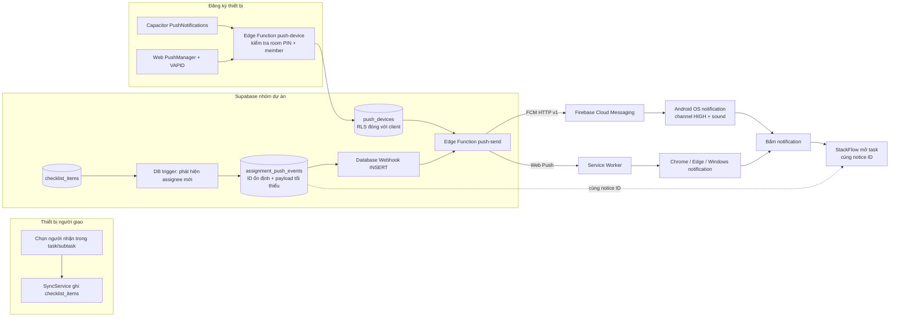

# Kiến trúc push notification cho nhóm StackFlow

## Mục tiêu

Khi một thành viên được giao task hoặc subtask, các thiết bị đã đăng ký của người đó nhận thông báo hệ thống có nội dung, âm báo và có thể mở đúng task. Hoạt động khi Android app chạy nền hoặc process bị hệ điều hành đóng; không đảm bảo sau khi người dùng Force stop app, tắt quyền notification, hoặc hệ thống bật Do Not Disturb.

## Sơ đồ

## Trách nhiệm và dữ liệu

- `checklist_items` là nguồn dữ liệu duy nhất cho task và danh sách assignee. Database trigger chỉ ghi sự kiện khi member vừa được thêm vào assignee hoặc subtask; bỏ qua tự giao việc và task đã hoàn thành theo logic domain hiện tại.
- `assignment_push_events` là outbox phía server. Unique notice ID khớp ID do `notificationDiffEngine` tạo để hợp nhất hộp chuông và push, không tạo một bản ghi thông báo thứ hai ở client.
- `push_devices` lưu token FCM hoặc Web Push subscription. Chỉ Edge Function dùng service role được đọc/ghi; không mở bảng này qua anon/authenticated.
- `push-device` xác nhận workspace PIN và member thuộc workspace trước khi liên kết token. App hiện chưa có tài khoản riêng cho từng thành viên, nên PIN phòng không chứng minh danh tính cá nhân nếu nhiều người cùng biết PIN. Đây là giới hạn bảo mật của mô hình đăng nhập hiện tại.
- `push-send` tra thiết bị người nhận, gửi FCM/Web Push, lưu trạng thái gửi và xóa token không còn hợp lệ. Service account Firebase, Web Push private key và webhook secret chỉ được lưu ở Supabase Edge Function Secrets.
- Android dùng channel riêng `stackflow_assignments_push_v1`, importance HIGH và sound mặc định. Channel cần ID mới nếu đổi importance vì Android không cho app âm thầm thay đổi cấu hình channel đã tạo; người dùng vẫn có quyền đổi âm lượng hoặc tắt channel.
- Web Push dùng VAPID và service worker hiện tại. Windows quyết định âm lượng/kiểu banner theo quyền của trình duyệt và cài đặt hệ thống.

## Trình tự triển khai

1. **Chốt Firebase app**: Android package phải là `com.quang.stackflow`; tạo Firebase project, đăng ký Android app, bật Cloud Messaging, tải `google-services.json`.
2. **Chuẩn bị secrets**: Firebase service account cho FCM HTTP v1; webhook secret; cặp VAPID cho Web Push. Không commit secrets vào Git hoặc APK.
3. **Cài backend**: chạy `supabase/push.sql`; deploy `push-device` và `push-send`; cấu hình secrets; tạo Database Webhook cho INSERT `assignment_push_events` trỏ đến `push-send`.
4. **Cấu hình build**: dùng `google-services.json` lúc build Android và VAPID public key lúc build web. Không ghi service account private key vào build client.
5. **Ký APK nội bộ ổn định**: tạo release keystore do nhóm giữ; lưu keystore và mật khẩu trong GitHub Actions Secrets hoặc ký local. Dùng cùng keystore cho mọi bản cập nhật để Android cho phép cài đè. Phát hành APK riêng qua kênh nội bộ; không cần Play Store.
6. **Bật quyền trên thiết bị**: cài APK đã cấu hình, mở app, chọn member, bật chuông và cấp quyền Android 13+. Đăng ký token lên `push_devices`.
7. **Kiểm thử hai thiết bị**: giao task từ tài khoản/thiết bị sender; kiểm tra receiver khi app mở, chạy nền, vuốt khỏi Recent Apps, bấm notification để mở task, và xác nhận chỉ có một notice.

## Cổng nghiệm thu

- Một event server tạo tối đa một notice ID cho một lần giao việc tới một thành viên.
- Token không xuất hiện trong log client hoặc truy vấn anon.
- Android ở nền nhận banner có âm; bấm vào mở đúng task; foreground không tạo notification kép.
- Token lỗi được gỡ và lỗi gửi còn truy vết được qua `last_error`.
- APK cập nhật được cài đè bằng cùng chữ ký, không yêu cầu phát hành Store.

## Các skill áp dụng

- `clean-data-governance`: trigger/event dùng dữ liệu chuẩn hóa hiện có; business rule giao việc không bị nhân đôi trong UI.
- `mobile-web-notification-adapter`: adapter theo nền tảng, permission, ID chống trùng và click routing.
- `non-tech-ux-craft`: xin quyền từ thao tác chủ động trong chuông; trạng thái cấu hình lỗi diễn đạt cho người dùng.

Không tạo skill mới ở giai đoạn kiến trúc. Ba skill hiện có đã bao phủ quy tắc domain, adapter và UX; khi bước triển khai cần một skill riêng, dùng cùng convention YAML frontmatter `name`/`description`, phạm vi hẹp, quy tắc bắt buộc và workflow kiểm chứng như các skill trong `.agents/skills/`.
